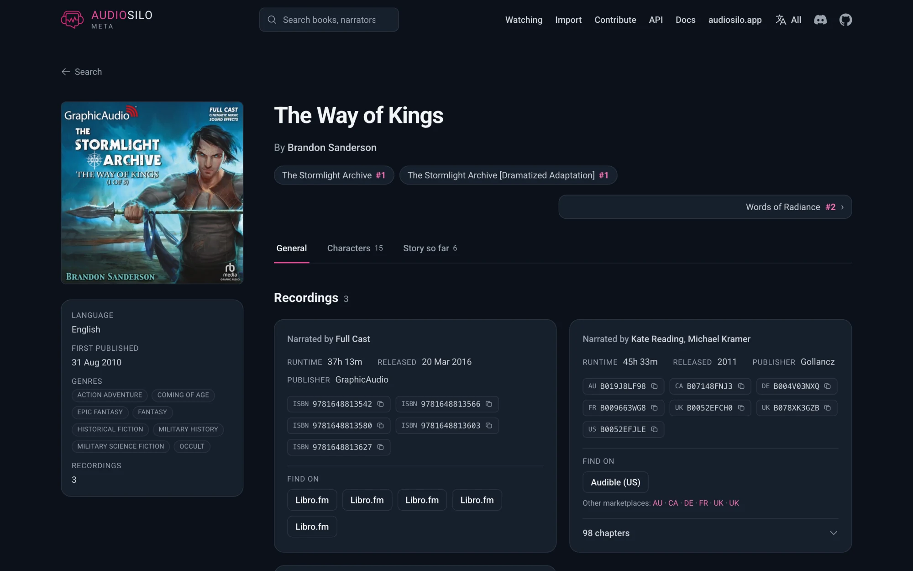

# audiosilo-meta

> **Use of AI:** AudioSilo is developed by me (a human), with assistance from AI, primarily Claude Code, to help me write, clean up, document, and review the code. That doesn't mean the app is generated on autopilot or "vibe coded". Nothing goes out until I've read it, tested it, and decided it belongs. AI is what lets one person keep up this pace, and I think it's important to disclose that.



[Website](https://audiosilo.app) · [Metadata](https://audiosilo.app/metadata) · [Docs](https://docs.audiosilo.app) · [Discord](https://discord.gg/nFFqRbkRn6) · [Sponsor](https://github.com/sponsors/KodeStar)

The open source community audiobook database behind
[meta.audiosilo.app](https://meta.audiosilo.app) - audiobook metadata, in the open.

**The GitHub repository is the database.** Metadata lives as plain JSON pack
files - many records to a file, addressed by slug range
([PACK-SPEC.md](PACK-SPEC.md)) - edited by pull request or issue form, validated
by Go tooling in CI, and compiled into a single SQLite artifact that servers
consume.

> **Status: Phase 1 shipped, Phase 2 landed.** Governance, schemas, the
> validation/build pipeline, the OpenAudible and Libation importers, the
> read-only **API server** (`metaserve`), the **website** (`site/`, served by
> metaserve at meta.audiosilo.app), the Docker image, the in-browser `/import`
> diff, the **Audiobookshelf** metadata-provider endpoint, and issue-form intake
> automation are all built. The characters/recaps CC BY-SA layer (Phase 2) is
> live across the schema, tooling, and data - and since 2026-08-21 it lives in
> its own repository,
> [audiosilo-meta-community](https://github.com/KodeStar/audiosilo-meta-community),
> which the release build composes into the same artifact. Still open: Open
> Library / Wikidata crosswalk seeding. Only claim what exists.

## Why this exists

No existing open database is both **audiobook-specific** and
**community-editable**:

- Open Library, Wikidata and Inventaire are open (CC0) but have essentially no
  audiobook structure - no narrator field of substance, no chapters, no runtime.
- BookBrainz has no audiobook format and no narrator field.
- Audnexus (the backend Audiobookshelf and Plex read from) is a read-only cache
  over Audible's own catalogue; its own README says it exists only "during the
  interim of waiting for a community driven audiobook database."

So narrators, specific recordings, and chapters are treated here as
**first-class data** - the fields every other database lacks, and the reason this
project exists.

## How the pipeline works

```
  contributor
      │  pull request  /  issue form
      ▼
  data/*.json  ──►  CI validation  ──►  meta.sqlite  ──►  API server + site
  (the database)    (metacheck +        (release          (metaserve,
                     metafmt, Go)        artifact)          read-only)
```

1. Contributors add or edit JSON files in `data/` (by pull request, or via issue
   forms that become pull requests).
2. CI validates every pull request - schema, canonical formatting, referential
   integrity, and identifier uniqueness. A red pull request never merges.
3. On merge to `main`, a release workflow builds `meta.sqlite` and attaches it
   (gzipped, with a checksum) to a dated GitHub Release.
4. Servers download that artifact and serve a read-only API. All writes go
   through GitHub; there are no server-side accounts.

## The data model

- **Work** - the abstract book (title, authors, language, series membership).
- **Recording** - a specific narration of a work (narrators, abridged flag,
  runtime, release date, publisher, region-scoped ASINs, ISBNs, cover URL,
  chapters). One work, many recordings. A production released in several
  marketplaces stays *one* recording: an ISBN may be written as
  `{"isbn": ..., "region": ...}` when the region is known, and `publishers[]`
  records the other regions' imprints beside the publisher of record. A LibriVox
  recording also carries its project id (`librivox_id`), its archive.org item
  (`archive_id`), `links` (catalogue page, zip, RSS) and an `audio_url` per
  chapter (one per LibriVox section).
- **Person** - a human shared across roles (author on works, narrator on
  recordings; can be both).
- **Series** - a named series with an ordered list of member works (string
  positions such as `"2.5"`).

*Harry Potter and the Philosopher's Stone* is one **work** with two
**recordings** - Stephen Fry and Jim Dale - each carrying its own ASINs. That is
the shape this project is built around. Full details in
[CONTRIBUTING.md](CONTRIBUTING.md).

## Repository layout

```
data/          the CC0 database: works/, people/, series/ + redirects.json (range-packed JSON, see PACK-SPEC.md)
               (the CC BY-SA characters/recaps layer lives in KodeStar/audiosilo-meta-community)
schema/        JSON Schemas (one per entity) - authoritative field definitions
cmd/           Go tooling: metacheck (validate), metafmt (canonicalise), metabuild (SQLite), metaserve (API server)
pkg/           public Go packages: the data model, pack storage and checks, and the read side
               (query: the artifact's queries and the JSON API handler; release: the data-release fetcher)
internal/      shared Go packages behind the tooling (build, serve, importer, ...)
Dockerfile     container image: API server + static site (no baked data)
.github/       issue forms + CI workflows (check, release, image)
CONTRIBUTING.md  GOVERNANCE.md  LICENSING.md
```

## Quickstart

Requires **Go 1.26+** (pure Go, no cgo, no external services).

```sh
git clone https://github.com/kodestar/audiosilo-meta
cd audiosilo-meta

# The gate - run before opening a pull request:
go build ./... && go vet ./... && go test ./... && \
  go run ./cmd/metacheck --profile core && go run ./cmd/metafmt --check --profile core

# Build the CORE-ONLY SQLite artifact locally (validates first). The REAL
# artifact composes both repositories - add --community <community-checkout>/data:
go run ./cmd/metabuild -o meta.sqlite
```

- `--profile core` is what CI passes, and what this repository's tree is: works,
  people, series. Without it the tools read the root as a whole database and
  quietly adopt a stray `data/works-community/` file that CI reports as an
  unrecognized location - so a green local run would not mean a green PR.
- `metacheck` - schema, referential integrity, and uniqueness validation.
- `metafmt --check` / `--write` - canonical JSON (sorted keys, 2-space indent,
  trailing newline) plus pack placement: `--write` moves an entry to the pack its
  slug belongs in and splits a pack that has outgrown its caps, so nobody has to
  work placement out by hand.
- `metabuild -o meta.sqlite` - compile the database into a SQLite file
  (`--community <dir>` composes the community checkout in; without it the
  artifact is the core half only). A work's
  `added_at` comes from the record; one that carries none falls back to the
  newest `sources[].imported_at`.
- `metamigrate` - the one-off conversion of a pre-pack, file-per-record tree into
  the pack layout (`--out <dir>` to rehearse without touching the source).

## Running the API server

`metaserve` is a JSON API over the compiled artifact, which it only ever reads - FTS
search, work/person/series detail, chapter lists, ASIN/ISBN/LibriVox lookup and a
LibriVox-shaped feed. All data is public, so reading it needs no auth; the API sends
permissive CORS, is rate limited per client and states a `Cache-Control`.

The query code and the API handler are the public Go package `pkg/query`
(`query.Open` + `query.NewHandler`), and the release fetcher is `pkg/release`, so
another program can serve the same API in-process from a downloaded artifact -
which is what an AudioSilo server's metadata mirror mode does. Because such a
consumer can read an artifact newer than its own code, artifact schema changes
stay additive (new tables and columns only).

```sh
# Dev: build the artifact, then serve it locally.
go run ./cmd/metabuild -o meta.sqlite
go run ./cmd/metaserve --db meta.sqlite --addr :8080

curl localhost:8080/healthz
curl 'localhost:8080/api/v1/search?q=dragon'
curl 'localhost:8080/api/v1/works/latest'
curl 'localhost:8080/api/v1/lookup?asin=B08G9PRS1K'
```

Key endpoints (all under `/api/v1`): `stats`, `search?q=&limit=`,
`works/latest?limit=`, `works/{id}`, `works/{id}/recordings/{rid}/chapters`,
`people/{id}`, `series/{id}`, `lookup?asin=|isbn=|librivox_id=`, `coverage`,
`coverage/works`, `coverage/series-gaps`, `librivox/audiobooks`, plus `/healthz`.

The LibriVox layer (artifact schema version 8). `search`, `works/search` and
`works/latest` take `?source=librivox` (any source type of the schema), which
keeps only works with a recording from that source - a typo is a 400, never an
empty list. Filtered, `works/latest` orders by the newest recording from that
source rather than by the work, so a new LibriVox reading of an old classic is
new. A LibriVox recording on `works/{id}` carries `librivox_id`,
`archive_id`, `links` (`librivox`, `zip`, `rss`, `text`) and `copyright_year`,
leads its `purchase_links` with a free `librivox` link, and its chapters carry
`audio_url`. `lookup?librivox_id=52` resolves a project id.
`librivox/audiobooks` (and `librivox/audiobooks/`) answers LibriVox's own
audiobooks feed - `id`, `since`, `title`, `author`, `genre` (exact, or a prefix
with a leading `^`), `extended`, `coverart`, `fields`, `limit` (default 50, at
most 500), `offset`, `sort_order`, JSON only - in LibriVox's JSON shape, so a
LibriVox app can switch by changing its base URL. It differs where the mirror
keeps no fact (empty descriptions, our genre vocabulary, a reader named only for
a one-narrator recording, `since` meaning "reached the mirror since"); the API
docs list each difference. Anyone wanting the whole catalogue should download
`meta.sqlite.gz` from the newest data release rather than page the feed.

Work-detail recordings also carry `purchase_links` - non-affiliate Audible and
Libro.fm URLs derived at response time from recording ASINs and 13-digit
recording ISBNs, with availability deliberately `unknown` (see the API docs).
The work page renders them: the server-rendered fact sheet lists every link, and
the island leads with the marketplace the reader's browser languages suggest,
keeping every other recorded region one click away.

`people/{id}` and `series/{id}` take an optional `?limit=&offset=` window and
report the unpaged totals (`authored_total`/`narrated_total`, `works_total`).
They differ in default: a person's credit lists are paged (100 per page, 500
max) because they are unbounded - a corporate credit such as "Full Cast"
narrates thousands of works - while a series returns every member work unless a
window is asked for, because the player's series rail is composed from the full
list.

The coverage endpoints back the site's contribute page. `coverage` returns the
top-line band only - how many works carry characters/recaps/whole-book recap
summaries - so it stays tiny at any catalogue size. `coverage/works?filter=&q=
&limit=&offset=` is the paginated, searchable browser: `filter` is `missing`
(missing any dimension) or `has_characters`/`has_recaps`/`has_recap_summary`; `q`
matches a work's title, authors, narrators and series through the same full-text
index as `search` (whole words and word prefixes, not mid-word substrings); the
response carries a per-filter
`available` flag that is
false when the dimension is not evaluable at the artifact's schema version.
`coverage/series-gaps?q=&limit=&offset=` is the paginated, name-searchable list
of series with interior position gaps.

Flags: `--db` (local artifact), `--site <dir>` (serve a static site at `/`),
`--poll` (fetch and hot-swap the latest published data release from GitHub),
`--repo` (default `KodeStar/audiosilo-meta`), `--interval` (default `1h`),
`--cache` (download dir). With `--poll` and no `--db` - what the container image
runs - the server fetches the newest data release (the newest release carrying
`meta.sqlite.gz`; code/image `v*` releases are skipped) on boot, streaming it to
the cache directory and verifying the published checksum before it counts. If
that first fetch fails the process does not exit. It first falls back to the
newest artifact already in the cache directory - what the previous container was
serving - and serves that, logged as stale, until a release loads. Only with
nothing cached does it come up empty (static site served, `/healthz` and every
API route 503 with a clear message, and a `Retry-After` reporting the wait
actually in force). Either way it retries after 30s and then backs off, doubling
up to `--interval`, so an unreachable GitHub is a logged outage rather than a
container crash loop. A restart while GitHub is reachable does not re-download
what the cache already holds either: the cached artifact for the newest release
is verified against that release's published checksum and adopted as is. With
`--db` as well, the local artifact serves immediately
and the poller still runs a refresh at startup (not just once per `--interval`).
Superseded artifacts are pruned from the cache after each hot-swap. Set
`GITHUB_TOKEN` to raise the API rate limit.

Rate limit and caching: every API route (`/api/v1/*` and `/abs/search`, not
`/healthz`) wears a per-client token bucket - `--rate-limit` requests a second
(env `METASERVE_RATE_LIMIT`, default 100, `0` turns it off) with a burst of
`--rate-burst` (env `METASERVE_RATE_BURST`, default 400; at least 1 while the
limit is on - a burst of `0`, or a negative rate, is refused at startup rather
than defaulted). The defaults are sized so an AudioSilo server's bulk match,
which does not pace itself, never trips them (the arithmetic is in
`internal/serve/ratelimit.go`). Past it a client gets
429 with `Retry-After`. The client is the connection's address, or, when that
address is one of `--trusted-proxy` (env `METASERVE_TRUSTED_PROXIES`, a
comma-separated list of addresses and CIDR prefixes), the rightmost
`X-Forwarded-For` entry that is not itself a trusted proxy (an IPv6 client
counts as its /64). **Behind a reverse
proxy, name it there**, or every request counts as the proxy and shares one
bucket; a forwarded header from anywhere else is never read. The shipped
`docker-compose.yml` trusts only the loopback and its own network's pinned
subnet (`METASERVE_SUBNET`, default `10.217.53.0/28`) - in practice that network's
gateway, which is where a host proxy on the loopback-only port arrives from. That
is right for a host proxy; a containerised proxy on another Docker network must
add its own address to `METASERVE_TRUSTED_PROXIES`, or every visitor shares one
bucket. Never trust the private ranges wholesale: a LAN client of the proxy could
then choose its own bucket. An existing deployment's first start after the subnet
was pinned needs `docker compose down && docker compose up -d` once. A 200 that states
no `Cache-Control` of its own gets `public, max-age=600`, or `public,
max-age=60` on the searches and `works/match`.

For immediate production refreshes, set `METASERVE_WEBHOOK_SECRET` to a random
value of at least 32 bytes while keeping `--poll` enabled. This registers
`POST /hooks/github/release`, authenticated with the standard
`X-Hub-Signature-256: sha256=...` HMAC header. The release workflow calls the
endpoint only after every release asset has uploaded, then metaserve re-queries
GitHub, verifies the published checksums, and uses the same atomic hot-swap path
as polling. The webhook never trusts or installs data from its request body.
Hourly polling stays enabled as a fallback for a missed delivery.

Configure the deployment and GitHub repository with the same secret:

1. Generate a secret, for example with `openssl rand -hex 32`, and expose it to
   the container as `METASERVE_WEBHOOK_SECRET`.
2. Add the Actions secret `METASERVE_WEBHOOK_SECRET` with that value.
3. Add the Actions secret `METASERVE_WEBHOOK_URL` with the public endpoint, for
   example `https://meta.audiosilo.app/hooks/github/release`.

The endpoint is not registered when the deployment secret is absent. A missing
workflow configuration or failed delivery is non-fatal because the fallback
poller will still discover the release.

A deployment can also offer the unknown-ASIN intake queue, which is off unless
configured. Set `METASERVE_INTAKE_DB` to a path for its SQLite file (in the shipped
compose file, `/data/intake/queue.sqlite` sits on the volume, outside the artifact
cache)
to register `POST /api/v1/intake/unknown-asins`, and `METASERVE_INTAKE_TOKEN` to a
random value of at least 32 bytes (`openssl rand -hex 32`) to register the bearer
token `GET` on the same path as well. The file holds each reported ASIN with a
count and its first and last UTC day, and nothing about who reported it; the POST's
limit (6 a day per client) holds a client's address in memory until about a day
after its last request, refused or not. That covers metaserve alone: a reverse proxy in front logs
what it is set to log, so check its access log for this route. The POST needs
`METASERVE_TRUSTED_PROXIES` right behind a proxy
even more than the API does, or every reporting server shares one 6-a-day bucket.
A queue file that cannot be opened is logged and leaves the routes off. Losing the
file is harmless, because servers report again. Unset the variable to turn it off:
the routes answer 404 and the spec no longer lists them.

### Docker

The image bundles the server and the static site (built from `site/`) - and no
data. On boot it downloads the newest published data release into the cache
volume, then accepts signed release refreshes when configured and polls as a
fallback. Keeping the catalogue out of the image means a site or server change
neither rebuilds nor ships the database, and the image size is independent of
how large the catalogue grows.

```sh
docker build -t audiosilo-meta .
docker run -p 8080:8080 -v audiosilo-meta-cache:/data ghcr.io/kodestar/audiosilo-meta:latest
```

For a real deployment use the committed [`docker-compose.yml`](docker-compose.yml):
loopback-only port (a TLS reverse proxy such as nginx/Ploi fronts it), a named
volume for the release-download cache, an optional signed release webhook, and
hourly fallback polling. The image entrypoint carries all required flags;
`command:` appends extras (for example `command: ["--interval", "15m"]`).
Health check endpoint: `/healthz` - a readiness check, so it answers 503
`{"status":"starting"}` until the first artifact has loaded.

The `image` workflow builds and pushes `ghcr.io/kodestar/audiosilo-meta` on a
`v*` tag.

## Scanning a local library (metascan)

`metascan` is the low-friction way to contribute a library when you have only
audio files - no OpenAudible or Libation export. Point it at a folder and it
walks the tree, gathers whatever metadata it can find, and writes a JSON file the
meta.audiosilo.app import page accepts.

```sh
go run github.com/kodestar/audiosilo-meta/cmd/metascan@main /path/to/audiobooks -o scan.json
```

Then drop `scan.json` onto **meta.audiosilo.app/import**.

It runs entirely on your machine and **sends nothing anywhere** - it only reads
files. What it gathers, per book:

- **Embedded tags** (via [dhowden/tag](https://github.com/dhowden/tag)): title,
  authors, narrators, and an ASIN when Libation/OpenAudible embedded one.
- **The folder structure**, treated as a first-class source (tags are often
  missing or wrong, series data especially): `Author/Book`,
  `Author/Series/Book`, and name patterns like `01 - Title`, `Book 3 - Title`,
  `Title, Book 3`, and `Jack Reacher 03 - Title` yield author/series/position/
  title.
- **An ASIN** - the anchor that makes a sparse book matchable - hunted in tag
  atoms and in file/folder names (for example `Title [B076HYPQLK]`).
- **Runtime and chapter counts**, if `ffprobe` is on your `PATH`. Without it the
  scan still works; those two fields are simply omitted.

Have `ffprobe` installed if you can: it is also the deeper tag reader. The pure
Go reader covers the common title/author/narrator tags plus MP3 user frames,
but several audiobook-specific fields are reachable only through ffprobe -
Audible/Libation freeform MP4 atoms (ASIN and friends), m4b stream language,
and various container extras. Without ffprobe, embedded series/ASIN extraction
is limited (especially for m4b files); the folder-structure heuristics still
work in full.

Every field records where it came from (`tag` / `path` / `filename`) in the
book's `sources` map, and unknown fields are omitted rather than guessed.
Grouping follows the workspace convention: a folder that directly contains audio
is one book (its files are the parts), and loose files at the scan root are
individual single-file books. One evidence-gated exception: when a folder's
files carry mutually distinct album tags (or distinct, non-generic title tags
that each match their own filename), that is a flat folder of separate
single-file books - the common `Series/01 - A.m4b, 02 - B.m4b` layout - and each
file becomes its own book, with the folder feeding the series/author heuristics.
Without tag evidence the folder is always kept as one book (never split on
filenames alone), and a multi-file folder with no signal either way is counted
in the summary so you know where to check for collections. The JSON goes to
stdout by default (or `-o <file>`); a human-readable summary goes to stderr.
Pass `-ffprobe ""` to skip ffprobe enrichment.

## Importing LibriVox (metaimport librivox)

LibriVox's catalogue is mirrored here under [LICENSING.md's public-domain
exception](LICENSING.md#the-public-domain-exception-librivox) - facts only, never
the project descriptions. It is two steps:

```sh
# 1) Fetch a local snapshot of LibriVox's audiobooks feed. Polite by design:
#    100 projects a page, 5 s between requests, a User-Agent naming
#    meta.audiosilo.app, Retry-After honoured on 429/5xx. Resumable: rerun the
#    same command after an interrupt. A response body over 64 MiB is no feed
#    page: it stops the run, never cut off. The snapshot is never committed.
go run ./cmd/metaimport librivox fetch --out ~/librivox-snapshot [--max-pages N]

# 2) Import a tranche of it by project-id range (offline; --dry-run first).
go run ./cmd/metaimport librivox import --from ~/librivox-snapshot --ids 1-2000 --dry-run
```

A snapshot is a directory: `manifest.json` (the fetch's resume state: feed,
query, limit, next offset, page and project counts, complete or not) and
`pages/offset-NNNNNNN.json`, each one feed response body verbatim. The importer
reads `pages/*.json` and needs nothing else, so a hand-assembled snapshot (the
test fixtures are one) works too. The fetcher records each page's range of
project ids and its size in the manifest (`page_ids`), and a tranche skips
every page whose range misses its `--ids` (0.19 s instead of 2.0 s for a
2,000-project tranche of the 22,449-project snapshot). A page the manifest does
not range (fetched before the ranges were recorded, a hand-assembled one) or
whose size has changed since is always decoded, and a decoded page holding an
id outside its range reads the snapshot whole. A project whose id is missing or
unreadable is skipped with a warning naming its page and title (no `--ids`
could select it).

What an import does: a project number LibriVox retired or holds for reuse (no
author, titled "DO NOT RE-USE PROJECT NUMBER" or "REUSE project number - ...")
is no book and is only counted (`librivox: set aside N retired or reusable
project numbers`). A project LibriVox is still recording (no `totaltimesecs`
and no archive.org item in `url_iarchive`; the feed has no status field) is set
aside before anything else and writes nothing, listed on one line of the report
(`librivox: skipped N in-progress projects ...: <ids>`), so re-importing its id
once LibriVox completes it lands it like any other; one the catalogue already
holds is counted as already present instead. A project whose
`librivox_id` is already catalogued is skipped (identity is the project id,
never the title), so a rerun changes nothing. Otherwise it becomes a new
recording - never merged into another recording - under the work these rules find, in order (LibriVox's repeat markers are
stripped from the title first: a trailing "(version 2)", "(ver 2)", "(ver. 2)"
or "(Dramatic Reading)", stacked or combined in one parenthetical, or a bare
"Version 2" ("Walden, Version 2", "Sea Wolf - Version 2"), "version" also as
Italian "versione", Spanish "versión" or Portuguese "versão", so a dramatic
reading or a numbered version is another recording of the plain-titled work; a
version number has one or two digits, so "(Version 1611)" is a year and stays;
and a version marker ending a parenthetical that names something else loses
only the marker: "Spring (Barber version 2)" is "Spring (Barber)", "Alice's
Adventures in Wonderland (abridged, version 2)" is "... (abridged)", an
abridged recording as "(abridged)" always is; a translation named "...
Version" keeps the word, so "(King James Version 2)" is "(King James
Version)"):

1. the importer's ordinary identity walk: same title, same identity authors,
   same language. An author or translator whose name slugs to nothing (a
   Cyrillic "Йордан Йовков") is never the one catch-all person record every
   such name would share: with a LibriVox author id it is a person of their own
   at `librivox-author-<author id>` (`librivox-author-17538`, the name kept as
   written); with none, the credit is dropped before the work is decided and
   listed under `credits not recorded` (`unsluggable`), and a project left with
   no individual author (only a translator, or only a collective such as
   Anonymous) goes to the worklist as `author-unsluggable`;
2. otherwise the ONE work by the same authors, in the same language, whose title
   differs only by a leading article or punctuation, case and accents ("The
   Metamorphosis" and "Metamorphosis" by Franz Kafka), or by how a volume is
   spelled ("Vol. 1 of 3" and "Volume 1"; two titles stating different totals,
   "Vol. 1 of 3" and "Vol. 1 of 5", are two volume sets and never match, and a
   work titled "Volume 1" that already holds a "Vol. 1 of 3" recording is the
   three-volume set: "Vol. 1 of 5" goes to the worklist as `volume-total`). The articles set aside
   are the English the/a/an, French le/la/les/l', German der/die/das, Spanish
   el/los/las, Italian il/lo and Dutch de/het/een. Failing that, the ONE such
   work by an author the project spells with more or fewer words (the same
   surname, one name's words a subset of the other's: "Henrietta Elizabeth
   Marshall" and "Henrietta Marshall") is attached too, the project's credit
   moved onto the catalogued person unless LibriVox's spelling is already a
   person record of its own; a looser likeness (an initial, another given
   name, a one-word name) is the worklist's `author-spelling`;
3. otherwise, when the title with its trailing parenthetical or bracketed
   qualifiers removed is a work's title under rule 2 ("Frankenstein (1818)",
   "Black Beauty (The Autobiography of a Horse)" by the same author), the
   project goes to the worklist as `differently-spelled-title` (`several-works`
   when more than one work matches), never attached: the qualifier can as well
   be a volume ("King in Yellow (part 1)");
4. otherwise a new work. A work by a different author under the same title is a
   different book, so it gets a work of its own.

A project that attaches to a work already in the catalogue adds its recording
(and its readers) only: a create run never edits a catalogued work's credits, so
an author or translator that work does not name is not recorded there, and no
person record is created for them (it would be credited nowhere). The import
report lists each such credit (project id, name, role, `librivox_author_id`,
work) under `credits not recorded`, for recording-level credits to pick up
later (meta#2752). A row of any other source (OpenAudible, Libation, AudioSilo
books, libex) that attaches to a catalogued work, or is relocated onto one,
follows the same rule, its credits listed there by ASIN.

No import ever credits the shared catch-all person. libex refuses a row naming
anyone whose name slugs to nothing; a user-library import (OpenAudible,
Libation, AudioSilo books) keeps the book and leaves that author, contributor
or narrator off it, listing each under `credits not recorded` by ASIN with the
reason `unsluggable` (also in a library-import issue's intake notes). A book
left with no individual author is skipped as `missing-author`, and one left
with no narrator as `missing-narrator`, each with a warning naming the names;
the library-import intake verdict says how many books were skipped this way
(they need a maintainer) rather than suggesting the file is the wrong format.

A match the rules cannot settle is never guessed: the project is skipped and
listed in the import report's **worklist**, one line per project with its id,
title, authors, a reason code and the catalogued works involved:

```
librivox worklist: 2 projects skipped for a person to resolve (re-import the ids once settled):
  99502 "The Metamorphosis" by Franz Kafka [several-works]: metamorphosis "Metamorphosis"; metamorphosis-2 "Metamorphosis"
  99503 "Metamorphosis: A Novella" by Franz Kafka [differently-spelled-title]: metamorphosis "Metamorphosis"
```

The reasons: `several-works` (two or more works qualify under rule 2),
`author-unmatched` (a work carries the title but its authors only partly agree),
`author-spelling` (a work carries the title by an author of the same surname
whose name only loosely agrees with the project's, or beside other
candidates), `author-unsluggable` (every individual author's name slugs to
nothing and carries no LibriVox author id), `author-slot-taken` (as
`author-unsluggable`, but the author's `librivox-author-<id>` slot is another
person's or a retired one; the run warns, and a co-author's credit is listed
not recorded as `librivox-author-slot-taken`), `differently-spelled-title` (the duplicate-identity guard holds
the book under a title rule 2 does not read as the same, such as a subtitle
apart, or rule 3's trailing qualifier), `volume-total` (rule 2's work holds a
recording stating another volume total), `same-name-author` (below) and `fallback-slug-taken` (below). Once a person has settled the work,
re-importing the project's id lands it. `--worklist <path>` appends the
worklist to a file as well, one NDJSON row per project (`librivox_id`, `title`,
`authors`, `reason`, `candidates`), on a `--dry-run` too, as `--conflicts`
does. The answer to a row is a **reviewed decision** in
`internal/importer/librivoxreviewed.json`, one entry per project with its reason:
`attach` lands the recording on the named work whatever the title and author
rules say (with `moves`, row person to work person, to carry a loose spelling's
LibriVox id onto the catalogued person), and `own-work` makes it a book of its
own (a separately named translation, a volume of a set, a stated edition, another
author's book of the name), minted on its own title chain past the
duplicate-identity guard. Each states the project's `title`, since LibriVox reuses
project numbers. It is an input of the importer, not a hand edit, so rebuilding the
mirror reaches the same work (attach rows are planned after every other row, so an
attach can name a work a later project creates; its `moves` key the author id for the
whole batch). A decision that cannot apply never
falls through to the rules: an attach naming no live work is the worklist's
`reviewed-work-gone`, one naming a work in another language `reviewed-other-language`,
an own-work whose walk reaches a work that is not a home of its text
`reviewed-own-work-taken` (it may be the one it was ruled apart from), and a project whose title's key has changed is
`reviewed-title-changed`. A row refused before routing (`same-name-author`,
`author-unsluggable`, `author-slot-taken`) keeps that refusal and the run warns that
it shadows the decision; a `same-name-author` hold is settled on the person: put the
`librivox_author_id` on the right record. An own-work beside its twin does not make
their key ambiguous to a refusal: the duplicate-identity guard of every source, and the
intake gate, still answer the twin (`check.SetApart`). `--attach-editions` and a
relocation, which place the recording, still read the two as ambiguous. `--conflicts` rows for these projects
carry `librivox_id`, since they have no ASIN, and so do the `--skipped` lines
(one `{"librivox_id","reason"}` NDJSON line per project refused under a
refusal code: an unknown language, no narrator, author or title, or the
duplicate-identity guard's `identity-duplicate`; the libex `--skipped` shape
with the project id in place of the ASIN).

Readers are the narrators, translators are `translator` credits, sections are
chapters (`start_ms` cumulative from each playtime, the section's file as
`audio_url`), the language name maps to a code (an unknown language is a
reported skip, never a guess) and genres map onto the vocabulary where one fits.
A **non-Latin title** - one that slugs to nothing, or one where more than half
of its letters are not Latin script (digits, punctuation and spaces are not
counted; the leading article is dropped first) - never walks a slug chain,
which would file it under the shared "untitled" fallback or under its Latin or
number fragment ("Сборник стихов 001" as "001"). It is matched by rule 2 alone
(its key keeps its own letters, so a second project of the same title by the
same author attaches, and "The Война и мир" meets "Война и мир"), and otherwise
its new work is created at `librivox-<project id>`, titled as LibriVox writes
it (`fallback-slug-taken` when that slug is already used). A book from any
other source (libex, a user library) with the same non-Latin title by the same
authors in a compatible language finds that work by the same key, rather than
minting a duplicate under its Latin fragment or "untitled". A title exactly half
Latin ("Anna Karenina (Анна Каренина)") stays on the slug rule.

People are keyed by `librivox_reader_id` / `librivox_author_id`: a known id
resolves to its catalogued person whatever the feed now calls them. A reader
whose name slugs to nothing (Greek, Cyrillic, CJK) is a person of their own at
`librivox-reader-<reader id>` (`librivox-reader-11294`), the name kept as
written, so two such readers are never one record and a rerun finds them by
id; so is an author or translator with a LibriVox author id, at
`librivox-author-<author id>` (above); one with no id stays a credit not
recorded. A project whose reader slugs to nothing and cannot be filed there (no
reader id, or the slot is another person's or a retired one) is skipped with a
warning, never credited to the catch-all. metacheck refuses the shared
catch-all `person`, and any work or recording crediting it, whatever the source.
A reader id is a person of its own even when the name is not: when the slug of
a reader's name is already held by a person carrying a different reader id
(LibriVox has several accounts called "Martina"), the reader is created at
`<name>-librivox-<reader id>` (`martina-librivox-634`), and the first holder of
the name (by project id, whatever order the import reads them in) keeps the
plain slug. Re-importing a project the catalogue already holds
moves a reader folded onto another reader's person (by an import before this
rule) onto their own; authors are not split. Nor is a reader stamped onto an
AUTHOR record (one carrying a `librivox_author_id`, or whose life ended before
2005, when LibriVox began - a birth or flourished year alone counts: no one
born in 1840, or who flourished in 1807, read for LibriVox - in whichever order
the run meets the two): a reader called Adam
Smith is `adam-smith-librivox-19341`, never Adam Smith (1723-1790). A living or
undated author of the same import and a reader of the same name are one person,
whichever project comes first.

An author id no person carries yet is checked against the person its name
meets before it is credited there. The decision is taken once per author id,
for the whole import and before any project is placed, against the person the
import would actually credit (after its spelling rules, initials included), and
every project of the id then credits that person: the result never depends on
the order the projects are read in.

- **Courtesy titles.** "Mrs. William Platt" is never folded onto "William
  Platt" when LibriVox lists them under two author ids in one import, whatever
  their years: both records are kept, and the import report lists the pair
  (`librivox worklist: N author id pairs one courtesy title apart`) for a
  person to merge or confirm, since LibriVox also keeps duplicate records of
  one author ("Mrs. C. M. Livingston" and "C. M. Livingston"). And "Sir Hugh Fraser" is not folded
  onto a catalogued Hugh Fraser who only narrates (when the dates cannot tell,
  the project goes to the worklist as below). A catalogued id holder keeps
  its own spelling. A bare name that would be a new person lands on the one
  catalogued record with a courtesy title or a military rank in front of it
  ("Frederick Treves" on Sir Frederick Treves, "Joseph H. Alexander" on Colonel
  Joseph H. Alexander) unless their years disagree or that record only
  narrates.
- **Same-name authors.** When the catalogued person is someone else (another
  `librivox_author_id` with other years; years that disagree, a flourished year
  outside the person's life included; or, with neither, a person credited only
  as a narrator who is not a LibriVox reader meeting an undated author, or only
  on works first published more than 25 years after the author's death - or,
  when LibriVox states only a birth year, after a hundred-year life from it -
  and sharing no title with the project; a generic title such as "Poems" or
  "Selected Essays" is not a shared title, though "Poems (Ballads of a
  Cheechako)" is), the
  author is a person of their own at the name with their years:
  `james-grant-1822-1887` ("James Grant (1822-1887)"), `richard-wilson-fl-1916` ("Richard Wilson (fl. 1916)"). With no
  year to tell them apart, the author is a person of their own at
  `<name>-librivox-author-<author id>` (`ralph-scott-librivox-author-16428`,
  beside a retail narrator called Ralph Scott), and the import report lists the
  pair (`librivox worklist: N author ids filed at <name>-librivox-author-<id>`)
  to merge or confirm, since LibriVox may list one person under two
  ids; a collective such as "Anonymous" is never split this way. When the
  catalogued person's works are dated only
  by their recordings' release dates (a modern book and a modern edition of an
  old one look alike there), the project goes to the worklist as
  `same-name-author`, naming that person's works. Settling it means putting the
  `librivox_author_id` on the right person (the catalogued one, or a new dated
  record); re-importing the id then finds that person by id. A work is dated by
  its text: its first publication, or the copyright year a LibriVox recording of
  it states. And release dates stop counting against the author when a
  project they wrote (not one they translated, nor an anthology of more than two
  authors) shows they are editions: the
  catalogue holds that text, under its full title (never a generic one such as
  "Poems"), by a co-author the project also
  credits (that very person, not merely a shared surname), dated only by a release long after the author
  died ("Narrative of Sojourner Truth", 1850, beside Olive Gilbert's edition of
  2009). Two new author ids
  of one name in a single import are told apart the same way: the second is
  the first's person only when both state the same birth and death years, else
  dated or at its author-id form, as a later import would decide it.
- **One person under two LibriVox ids.** LibriVox lists some people twice: two
  author records (F. P. Walter 6492 and 6858), or two reader accounts (Branko
  Collin 778 and 1775). An import never records the second id: a reader's is
  filed beside the first, an author's is told apart by the rules above (the same
  years land the credit on the first's record, the id stays unrecorded; no year
  files it beside them, on the report's "beside a same-name person" list). Once
  the evidence says one person (the same text, the same years, the same site on
  both reader pages), the fold moves the credits, retires the twin's slug in
  `data/redirects.json` and records the second id in `librivox_author_aliases`
  or `librivox_reader_aliases` on the surviving person. An import resolves an
  alias as it does the record's own id, so the twin is not minted again, and
  metacheck refuses a retired slug of a LibriVox id form whose target does not
  answer to that id. Evidence of two people is a reviewed `merge-people` rejection
  in `internal/audit/reviewed.json` instead. No run writes either.

## Audiobookshelf

`metaserve` doubles as an **Audiobookshelf custom metadata provider**. An ABS
admin adds it under **Settings -> Item Metadata Utils -> Custom Metadata
Providers** with the URL `https://meta.audiosilo.app/abs` and no authentication
(the data is public); it needs ABS **v2.8.0 or newer**. Once added it appears in
each book's **Match** / **Quick Match** picker (it is not used by the background
scanner), for book libraries only.

The endpoint is `GET /abs/search`. ABS sends `?mediaType=book&query=<title>`
(with optional `&author=` and `&isbn=`) and never an ASIN; the server returns
`{"matches": [...]}` with one entry per **recording**, up to 10 - an exact ISBN
lookup first, otherwise an FTS title search with loose author boosting. Each
match carries title, subtitle, author, narrator, publisher, publishedYear,
description, cover, ISBN, ASIN, series + sequence, language, duration (in
minutes), and genres when the work carries them (values from the project's own
normalized genre vocabulary - never a retailer's category tree). Tags are
deliberately never returned. The [`/audiobookshelf`](https://meta.audiosilo.app/audiobookshelf)
site page walks through both directions (adding the provider, and exporting an
ABS library into `/import`).

## Contributing

New contributions are welcome - by direct pull request or by issue form (no JSON
required). Start with [CONTRIBUTING.md](CONTRIBUTING.md); the merge policy and
trust tiers are in [GOVERNANCE.md](GOVERNANCE.md).

Data rules in brief: factual fields only, no publisher blurbs, covers as URLs,
own-words descriptions, `sources[]` on every record, and a CC0 dedication for
every submission.

## Licensing

| What | Licence |
|---|---|
| Code (tooling, schemas, CI, future server) | **AGPL-3.0-only** ([`LICENSE`](LICENSE)) |
| Data - factual core (works, recordings, people, series) | **CC0-1.0** public domain dedication |
| Data - derived layer (characters and recaps) | **CC BY-SA 4.0**, in its own repository: [audiosilo-meta-community](https://github.com/KodeStar/audiosilo-meta-community) |

**This repository holds no share-alike content.** Since the community-repo split
the CC BY-SA layer is a separate repository; the release artifact is composed
from both, so `meta.sqlite` still carries characters and recaps and each record
states its own licence.

Publisher blurbs and cover art are referenced, never copied. Full policy,
including the takedown / rightsholder opt-out channel, in
[LICENSING.md](LICENSING.md).

## Roadmap

- **Phase 0** (done) - governance, schemas, CI validation, the SQLite builder, and
  hand-curated records that prove the pipeline (including multi-recording works).
- **Phase 1** - the read-only Go API server (`metaserve`, FTS search + ASIN/ISBN
  lookup), the website (`site/` - search-first landing, stats, latest additions,
  work/person/series pages), the Docker image, the OpenAudible and Libation
  importers, the public deployment (meta.audiosilo.app), the in-browser import
  page (`/import` - parses an OpenAudible export, a Libation export, an
  Audiobookshelf library export, or a metascan folder scan client-side and diffs
  it against the live catalogue), and **issue-form intake automation** (a data
  issue form becomes a validated bot pull request - see
  [GOVERNANCE.md](GOVERNANCE.md)) have **landed**. Still planned: seeding from
  Open Library / Wikidata identifier crosswalks.
- **Phase 1.5 - AudioSilo player integration** - the AudioSilo server
  (`GET /libraries/{id}/meta`) and player surface enriched metadata from this
  database, capability-gated and behind an admin off-switch. This priority
  integration has **landed**, and the **Audiobookshelf metadata-provider facade**
  (`GET /abs/search`, see above) has now shipped on top of it.
- **Phase 2** - community-authored characters and recaps under strict length and
  originality rules, in a separately-tagged CC BY-SA layer, have **landed**: the
  schema enforces the layer structurally, `metacheck` validates it, and
  `metabuild`/`metaserve` ship it. The layer itself now lives in
  [audiosilo-meta-community](https://github.com/KodeStar/audiosilo-meta-community),
  which is also where its issue forms and its authoring guide are; the release
  artifact is composed from the two repositories.
- **Phase 3+** - the source-to-sidecar extraction tooling (`metaextract` plus the
  documented agent process) has **landed**; deeper player rendering gated by the
  listener's progress position is in progress.

Community: questions, contribution help, and coordination happen on the
[AudioSilo Discord](https://discord.gg/nFFqRbkRn6) and in GitHub Discussions.

Design basis: the workspace feasibility study (`../META-FEASIBILITY.md`).
